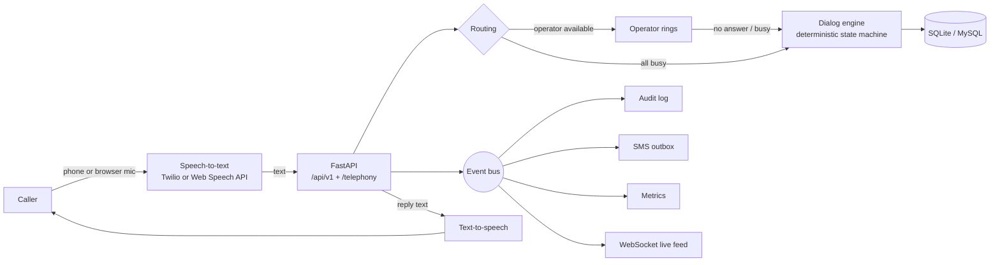

# 📞 VoiceDesk Bank Agent

A **voice-agent backend for bank call centres**. When every human operator is busy (or does not pick up in time), an AI agent answers the call, verifies the customer, and completes common requests: **balance inquiry, card block, card activation, PIN change, address change, and complaint registration**. Customers in an emergency no longer wait in a queue.

> **Demo product.** The bank ("Demo National Bank"), its helpline number, all customers, CNICs and balances are **fictional**. See [Limitations](#limitations-read-this-before-production).

   

## Why this design

| Requirement | How it is solved |
|---|---|
| Operators are busy → agent takes over | **Operator-first routing**: an available operator rings first; if all are busy/offline, or nobody answers within `RING_TIMEOUT_SECONDS`, the agent takes the call automatically (background sweeper + lazy check). |
| "Without hallucination" | The dialog engine is a **deterministic state machine**. No generative model: every sentence is a fixed script or filled from the database. Unknown requests get a scripted menu, then a callback request. |
| Emergency handling | Emergency words (stolen, lost, fraud, hacked…) raise the call to **high priority** and shortcut to card blocking; fraud complaints offer an immediate card block. |
| Identity | CNIC + date of birth, 3 attempts per call, account lock after 5 failures, identical error for unknown CNIC vs wrong DOB (no account enumeration). |
| Pub/sub | In-process **event bus** (wildcard topics, sync/async handlers, failure isolation, dead letters) feeding audit log, SMS outbox, metrics and a live WebSocket feed. Outbox pattern: commit first, publish after. |
| Privacy | CNIC stored only as a peppered HMAC; PINs as salted PBKDF2 hashes and **never** logged; CNIC/DOB/PIN/address speech is redacted from transcripts; secrets are stripped from events. |

## Architecture



More detail in [docs/ARCHITECTURE.md](docs/ARCHITECTURE.md).

## Quick start

```bash
git clone <your-repo-url> voicedesk-bank-agent && cd voicedesk-bank-agent
python -m venv .venv && source .venv/bin/activate
pip install -r requirements-dev.txt
cp .env.example .env            # then set API_KEY and CNIC_PEPPER
uvicorn app.main:app --reload   # http://127.0.0.1:8000
```

* **Demo UI** (call simulator + operator desk + live events): <http://127.0.0.1:8000/>
* **Interactive API docs**: <http://127.0.0.1:8000/docs>

Docker: `docker compose up --build` (see [docs/DEPLOYMENT.md](docs/DEPLOYMENT.md) for Render and MySQL).

### Try a call

Demo customer (fictional): CNIC `35202-1234567-1`, date of birth `15 March 1990`.

```bash
BASE=http://127.0.0.1:8000
CID=$(curl -s -X POST $BASE/api/v1/calls -H 'Content-Type: application/json' \
      -d '{"caller_phone":"+923001234567"}' | python -c "import sys,json;print(json.load(sys.stdin)['call_id'])")
say() { curl -s -X POST $BASE/api/v1/calls/$CID/message -H 'Content-Type: application/json' \
        -d "{\"text\":\"$1\"}" | python -c "import sys,json;print(json.load(sys.stdin)['reply_text'])"; }
say "what is my balance"; say "35202-1234567-1"; say "15 March 1990"
```

More demo customers and scripted flows: [docs/CONVERSATION_FLOWS.md](docs/CONVERSATION_FLOWS.md).

## API overview

Full reference: [docs/API.md](docs/API.md) (also live at `/docs`).

| Method & path | Auth | Purpose |
|---|---|---|
| `POST /api/v1/calls` | public | Start a call (operator-first routing) |
| `POST /api/v1/calls/{id}/message` | public | Send what the caller said → agent reply (`reply_text`, `reply_speech`) |
| `GET /api/v1/calls/{id}` | public | Call state + redacted transcript |
| `POST /api/v1/calls/{id}/end` | public | Hang up |
| `GET /api/v1/calls` | API key | Recent calls |
| `GET/PUT /api/v1/operators…`, `POST …/accept` | API key | Operator desk |
| `GET/PATCH /api/v1/complaints…` | API key | Complaint management |
| `GET /api/v1/events`, `GET /api/v1/stats` | API key | Audited pub/sub events, metrics |
| `WS /ws/events?key=` | API key | Live event feed |
| `POST /telephony/incoming|gather|resume` | Twilio signature | Phone-call webhook (TwiML) |
| `GET /health`, `GET /ready` | public | Liveness / readiness |

Admin calls send `X-API-Key: <API_KEY>`.

## Testing

```bash
pytest --cov=app                          # 152 tests, ~96% coverage
python scripts/smoke_test.py              # end-to-end against a RUNNING server
python scripts/smoke_test.py https://<your-url> <API_KEY>   # against your deployment
```

Built test-first (red → green): [docs/TESTING.md](docs/TESTING.md).

## Project structure

```
app/
  main.py            app factory, lifespan (tables, seed, ring-timeout sweeper), WebSocket
  config.py          settings from environment
  models.py          SQLAlchemy models
  routing.py         operator-first routing (atomic operator claim)
  services.py        call lifecycle, fallback to agent, operator actions
  events.py          pub/sub event bus
  subscribers.py     audit, SMS outbox, metrics, WebSocket subscribers
  security.py        hashing, masking, redaction, Twilio signature
  agent/nlu.py       intent + entity extraction (English + Roman Urdu keywords)
  agent/dialog.py    deterministic dialog state machine
  api/               REST routers + telephony webhook
  static/index.html  demo UI
tests/               unit + integration tests
docs/                product brief, roadmap, architecture, API, flows, testing, deployment
scripts/smoke_test.py
```

## Configuration

All settings are environment variables (see [.env.example](.env.example)). Important ones: `API_KEY`, `CNIC_PEPPER` (**change both**), `DATABASE_URL`, `RING_TIMEOUT_SECONDS`, `MAX_AUTH_ATTEMPTS_PER_CALL`, `TWILIO_AUTH_TOKEN`, `PUBLIC_BASE_URL`.

## Limitations (read this before production)

* **Fictional data & number.** Nothing here is a real bank, line or customer.
* **Verification is knowledge-based (CNIC number + date of birth).** A phone call cannot check a physical "original CNIC". Production banking needs a second factor (OTP to the registered mobile, voice biometrics) and core-banking integration. See [docs/ROADMAP.md](docs/ROADMAP.md).
* **Speech-to-text / text-to-speech run outside the server** (browser Web Speech API in the demo, Twilio for phone). The API receives transcribed text.
* **Pub/sub is in-process** (single worker). For several instances swap `EventBus` for Redis/Kafka. The Dockerfile runs one worker for this reason.
* The Twilio webhook is covered by simulated-request tests; it has not been exercised against a live Twilio account. Docker/Render files were written but not built or deployed in the authoring environment.
* Replies are in English; Roman Urdu keywords are understood for intents. MySQL is supported through `DATABASE_URL` but the test-suite runs on SQLite.

## Roadmap & documentation

[Product brief](docs/PRODUCT_BRIEF.md) · [Roadmap](docs/ROADMAP.md) · [Architecture](docs/ARCHITECTURE.md) · [API](docs/API.md) · [Conversation flows](docs/CONVERSATION_FLOWS.md) · [Testing](docs/TESTING.md) · [Deployment](docs/DEPLOYMENT.md) · [LinkedIn post draft](docs/LINKEDIN_POST.md)

## License

MIT, see [LICENSE](LICENSE).
