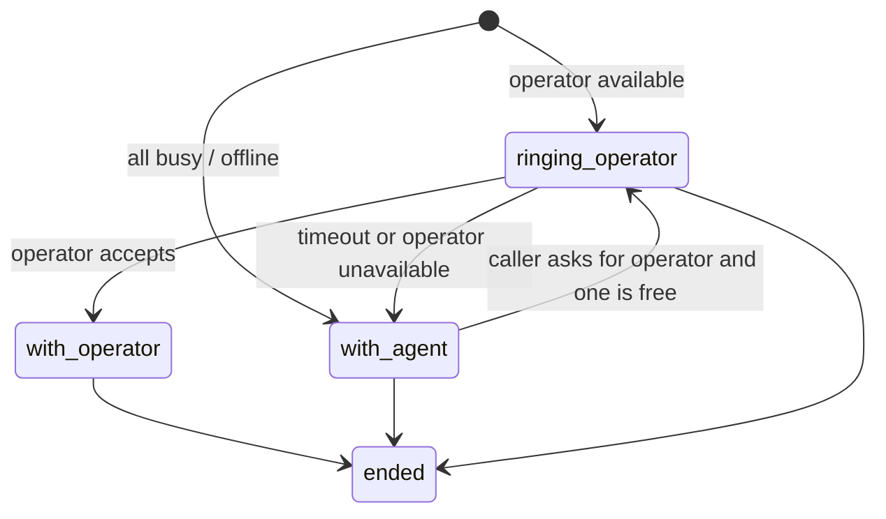

# Architecture

## Components
| Module | Responsibility |
|---|---|
| `api/` | Thin FastAPI routers: validate, call services, commit, then publish events. |
| `services.py` | Call lifecycle (start, message, end), fallback to agent, operator accept/status. Returns events instead of publishing them. |
| `routing.py` | Operator-first assignment. `claim_operator` is one conditional `UPDATE … WHERE status='available'`, so two simultaneous calls cannot reserve the same operator. |
| `agent/nlu.py` | Rule-based intent and entity extraction (digits incl. spoken words, dates, yes/no). |
| `agent/dialog.py` | State machine: states `menu → auth_cnic → auth_dob → (card_select → confirm_block | activate_verify | pin_new → pin_confirm | addr_new → addr_confirm | complaint_desc) → menu`. |
| `events.py` | Event bus. |
| `subscribers.py` | Audit log, SMS outbox, metrics counter, WebSocket broadcast. |
| `security.py` | HMAC CNIC hash, PBKDF2 PIN hash, weak-PIN check, redaction, API-key and Twilio-signature checks. |

## Call routing

The timeout is enforced two ways: a background task (`sweeper`, every `SWEEP_INTERVAL_SECONDS`) and a lazy check whenever the call or operator list is read or a message arrives. Authentication state survives the fallback.

## Pub/sub

Topics (dotted): `call.started`, `call.routed`, `call.transfer_requested`, `call.operator_accepted`, `call.fallback_to_agent`, `call.priority_raised`, `call.ended`, `auth.succeeded`, `auth.failed`, `auth.locked`, `auth.call_blocked`, `card.blocked`, `card.activated`, `pin.changed`, `address.changed`, `complaint.created`, `complaint.updated`, `operator.status_changed`.

* Subscribe with exact topics or patterns (`call.*`, `*`). Handlers may be sync or async and run in subscription order.
* A failing handler never blocks others; it is recorded in `bus.dead_letters` (exposed as a count in `/api/v1/stats`).
* **Outbox pattern**: services return events; the API commits the DB transaction first and publishes afterwards, so subscribers never see uncommitted state.
* Subscribers: audit (`audit_log` table), SMS outbox (`notifications` table), metrics, WebSocket feed. Payloads never contain CNIC, DOB or PIN (and `sanitize()` strips such keys defensively).

## Why no generative model
Banking replies must be factual. Every sentence is a fixed script or filled from the DB, so the agent cannot invent a balance, rate or policy. Misrecognised input leads to re-prompts, then a scripted fallback menu, then a callback request.

## Data model
`customers` (CNIC only as HMAC, masked copy) · `accounts` · `cards` (PIN as salted hash) · `operators` · `calls` (state + context JSON) · `transcripts` (redacted) · `complaints` · `audit_log` · `notifications` · `address_history`.

## Scaling notes
One process owns the event bus and WebSocket connections. To scale out: replace `EventBus` with Redis/Kafka, move the WebSocket fan-out to Redis pub/sub, and run the sweeper in a single elected worker (the conditional-UPDATE claim already makes operator assignment safe across processes).
